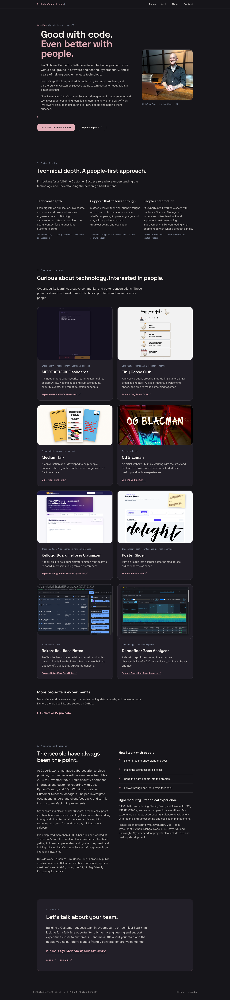

# Big Friendly Function

Nicholas Bennett’s professional website, prepared for [nicholasbennett.work](https://nicholasbennett.work/) as its canonical domain. Built with Astro 4, React 18, TypeScript, and Tailwind CSS 3. Big Friendly Function remains the site's personality and branding.

The homepage introduces Nicholas's move from software engineering into Customer Success Management in cybersecurity and technical SaaS. It follows hero → three contribution areas → selected projects and more experiments → experience/approach → contact, preserving the real portrait, charcoal and rose styling, and function motif. It describes engineering and support experience, collaboration with Customer Success Managers, and community organizing without claiming a prior CSM title or commercial ownership. Contact remains the existing email link, with GitHub and LinkedIn profiles.

## Site preview

[](docs/images/homepage.png)

Captured from the local production build with Playwright Chromium at 1440 × 1000, using a full-page screenshot. Regenerate with `npm run screenshot`; the image is a real rendering of the site, including its intentional project-media placeholders.

## Local setup

Use Node.js 22 LTS with npm. Python 3 is needed for the generated-page checker.

```sh
npm ci
npx playwright install chromium
npm run hooks:install
npm run dev
```

The development server normally runs at `http://localhost:4321`. Astro selects another port if that port is occupied. On Linux, Playwright may also require system packages: `npx playwright install --with-deps chromium`.

| Command | Purpose |
| --- | --- |
| `npm run dev` | Start Astro with live reload (`npm start` is an alias). |
| `npm run build` | Generate ten static pages, sitemap, and robots.txt into `dist/`. |
| `npm run preview` | Serve the production build locally after building. |
| `npm run check` | Run TypeScript checks; this does not type-check Astro templates. |
| `npm run check:site` | Check built routes, links, headings, metadata, images, and contact links. Run after building. |
| `npm run screenshot` | Build, start a temporary local server, capture the homepage, and stop the server/browser. |
| `npm run screenshot:check` | Check that the working-copy screenshot and manifest match the current source. |
| `npm run test:hooks` | Test the screenshot guards and hook behavior in temporary Git repositories; no remote push. |
| `npm run hooks:install` | Activate the versioned Git hooks for this clone. |

There is no configured lint task. The site loads its fonts from Google Fonts, so screenshot capture needs network access for those fonts, plus the installed Playwright Chromium browser.

## Site structure and content

Astro renders the homepage, eight project pages, and a portfolio presentation as static HTML. Only the responsive header hydrates as a React island for the mobile menu. No CMS, client-side router, or contact-form backend is required.

| Location | What to edit |
| --- | --- |
| `src/pages/index.astro` | Homepage section order. |
| `src/components/` | Header, hero, contributions, project gallery, experience/approach, contact, footer, and shared media presentation. |
| `src/data/projects.json` | Structured project copy, links, status, decisions, delivered work, plans, media, and content TODOs. |
| `src/data/linked-projects.json` | Additional repositories with project websites, short sourced descriptions, initial-commit dates, and GitHub links. |
| `src/data/projects.ts` | Media validation: absent local images fall back to a deliberate placeholder. |
| `src/pages/projects/[slug].astro` | Shared project-page template and static route generation. |
| `src/layouts/BaseLayout.astro` | Document titles, descriptions, canonical URLs, Open Graph metadata, and skip link. |
| `src/pages/sitemap.xml.ts`, `src/pages/robots.txt.ts` | Static discovery endpoints using the canonical site URL and project data. |
| `src/styles/global.css` | Shared styles, focus indicators, spacing, and reduced-motion behavior. |
| `tailwind.config.mjs` | Charcoal/rose palette and font tokens. |
| `public/` | Portrait, favicon, project media, and three existing engineering PDFs under `resumes/`. These remain accessible at their old URLs but are no longer promoted on the site. No Customer Success résumé has been fabricated. |
| `vercel.json` | Permanent host redirects from the legacy domains and the new `www` alias to the canonical apex. |
| `docs/domain-cutover.md` | Verified hosting/DNS observations, exact cutover steps, and production verification commands. |
| `docs/images/` | README screenshot and its source/image checksum manifest; these are not website assets. |
| `.githooks/` | Versioned merge and push hooks. |

Project routes:

- `/projects/mitre-attack-flashcards/`
- `/projects/tiny-goose-club/`
- `/projects/medium-talk/`
- `/projects/og-blacman/`
- `/projects/kellogg-board-fellows-optimizer/`
- `/projects/poster-slicer/`
- `/projects/rekordbox-bass-notes/`
- `/projects/dancefloor-bass-analyzer/`

Each route builds to its own `index.html`, supporting direct loads and refreshes on static hosting. The gallery and project pages use the same content. Live-site actions appear only for projects with supplied live URLs; source links are separate. Planned Kellogg and Poster Slicer refinements remain distinct from delivered work, and Dancefloor Bass Analyzer is labeled in development.

### Additional GitHub projects

The homepage also lists 27 additional projects curated from [nrrb’s public repositories](https://github.com/nrrb?tab=repositories), in a native expandable list below selected work. MITRE ATT&CK Flashcards and Tiny Goose Club now lead the selected projects alongside Medium Talk and have been removed from this additional list to avoid duplicates. Their screenshots were captured from their public HTTPS sites on November 5, 2026. The original October 29, 2026 snapshot covered all 63 public repositories and identified repositories with a nonempty GitHub website field; the selection has since been narrowed. Descriptions come from repository descriptions or READMEs, with the linked websites used when those sources contain no useful summary. Documentation and npm links are labeled accordingly. During the original link check, npm blocked automated requests with 403.

Each additional project shows the month and year of its first commit beside its name. `firstCommitDate` records the author timestamp of the oldest commit in the repository’s default-branch history, verified as a root commit through GitHub on October 30, 2026. Entries are stored newest first by that full timestamp; displayed dates use UTC to keep the month consistent across environments.

Edit `src/data/linked-projects.json` to maintain these entries and preserve the descending date order. This is a static content snapshot; the site does not call GitHub at runtime.

### One site and preserved links

This repository is the only website to be served at both domains after the approved cutover. No copy, assets, or configuration from the old nicholasbennett.work site have been imported. The old hosting project must relinquish the domain and be retired during cutover; see the domain guide. Original unrelated uploaded files in this repository's root are preserved. Existing `#resumes` and `#services` section anchors still resolve to the new contribution section.

### Adding project media

1. Find the media entry in `src/data/projects.json`.
2. Put the approved image under `public` at its reserved `assetPath` (for example, `public/images/projects/og-blacman/desktop-hero.png`).
3. Set `src` to the public URL, such as `/images/projects/og-blacman/desktop-hero.png`, and supply accurate `alt` text and a factual caption.
4. Build and regenerate the README screenshot.

Keep `src: null` until an asset exists. A nonexistent local file also renders a labeled placeholder. Images preserve their aspect ratios. The homepage uses the supplied laptop headshot at `public/images/portrait.jpg`; the shared layout also uses it for Open Graph and Twitter preview images. See [CONTENT_TODO.md](CONTENT_TODO.md) for missing screenshots, contribution details, credits, and optional recordings. The unverified WhatsApp destination is omitted pending a verified replacement.

## Screenshot and Git workflow

Work on a dedicated feature branch and commit coherent changes. Merge into `main` only when explicitly authorized. Hook installation is local Git configuration, so run `npm run hooks:install` once per clone. The installer preserves existing hook setups by refusing to replace a different `core.hooksPath` or active default hooks.

After an authorized merge into `main`, the `post-merge` hook runs `npm run screenshot`, including after a fast-forward merge. Review the image and commit the generated files if changed:

```sh
git add docs/images/homepage.png docs/images/homepage.json
git commit -m "docs: refresh homepage screenshot"
```

Before any push targeting remote `main`, `pre-push` checks the **exact outgoing commit**, even when the local branch has another name. It requires the README image, its manifest, and matching hashes of the site source, public assets, package files, configuration, and JavaScript tooling. A missing, stale, or modified image blocks the push with regeneration instructions. Changes only to README prose do not require a new capture.

The screenshot script waits for fonts and images, disables animation, and serves only the local build on an automatically allocated port. The manifest is a freshness check, not a pixel-diff test or proof of identical rendering across machines. Review visual changes before committing.

A failed post-merge capture cannot undo a completed merge; the pre-push guard still checks freshness. Feature-branch merges and pushes are unaffected. Deleting a remote branch does not trigger screenshot validation. These local hooks do not run for merges made through a remote web interface, and Git can bypass them with `--no-verify`. Squash merges and direct edits on `main` may need a manual capture; the pre-push check still applies.

No hook commits, pushes, or deploys automatically. If a capture fails, install dependencies/browser as needed, rerun `npm run screenshot`, review and commit the image and manifest, then retry the explicitly authorized push.

The automation uses [Playwright screenshots](https://playwright.dev/docs/screenshots) and Git’s documented [post-merge and pre-push hooks](https://git-scm.com/docs/githooks).

## Hosting

`astro.config.mjs` sets `output: 'static'` and the canonical site URL to `https://nicholasbennett.work`. Public HTTP headers confirm the existing Big Friendly Function site runs on Vercel. Build with `npm run build` and publish `dist/` in that same project. `vercel.json` prepares permanent 308 redirects for both legacy hostnames and `www.nicholasbennett.work`; DNS and Vercel domain assignments are separate dashboard changes. The canonical homepage, every project, the presentation, Open Graph images, sitemap, and robots.txt use the new apex domain.

Follow [the domain cutover guide](docs/domain-cutover.md) only after approval. It records current Namecheap DNS answers, explains how to obtain exact Vercel-assigned targets, and covers moving the new domain from the obsolete project without reusing its content. Local checks validate the redirect configuration; HTTP redirects and certificates must be tested after the approved deployment.

Pushing and deploying require explicit authorization. If a hosting provider is connected to `main`, a push may trigger a deployment. The screenshot workflow itself does not publish anything.
